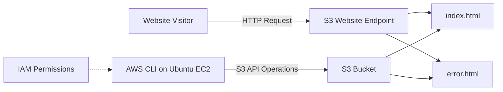

# Amazon S3 Static Website Hosting

> **Project Area:** AWS Cloud | **Service:** Amazon S3 | **Region:** Asia Pacific (Mumbai)

## Project Overview

This project demonstrates the deployment of a static portfolio website using Amazon S3. It includes website hosting configuration, object-level content delivery, a custom error page, and browser-based validation.

The project also integrates with the AWS CLI workflow documented in this repository, enabling website files to be downloaded, modified, and uploaded without manually replacing them through the console.

## Architecture

## Implementation

### 1. Storage and Hosting Configuration

An S3 bucket was created in the `ap-south-1` region and configured for static website hosting.

| Configuration | Value |
|---|---|
| AWS service | Amazon S3 |
| Region | `ap-south-1` |
| Index document | `index.html` |
| Error document | `error.html` |
| Hosting mode | Static website hosting |

### 2. Website Deployment

The website consists of two HTML assets:

- **`index.html`** — the main portfolio interface showcasing the SRB DevOps & Cloud profile.
- **`error.html`** — a custom cyberpunk-inspired error page.

Both files were uploaded to the S3 bucket through the AWS Console. The main portfolio page was opened successfully using the S3 website endpoint.

### 3. Public Access Configuration

A bucket policy was configured to allow public read access to website objects. This is required for visitors to retrieve the static content when the applicable S3 and account-level settings permit public access.

For production deployments, public access should be deliberately reviewed, confidential files must remain private, and a suitable least-privilege design should be used.

### 4. CLI-Based Content Update

The website was subsequently updated using AWS CLI on an Ubuntu EC2 environment:

1. Listed S3 buckets and website objects.
2. Downloaded `index.html` from S3.
3. Edited the HTML title locally.
4. Uploaded the modified file to S3.
5. Verified the updated object and viewed the change in a browser.

This validated the end-to-end object update workflow using the command line.

## Validation Results

| Test | Result |
|---|---|
| S3 bucket creation | Completed |
| Static website hosting | Enabled |
| `index.html` upload | Completed |
| `error.html` upload | Completed |
| Main website browser check | Successful |
| CLI-based HTML update | Successful |
| Custom error page on a nonexistent URL | Pending verification |

## Key Outcomes

- Deployed a static portfolio using Amazon S3 website hosting.
- Configured index and error documents.
- Applied a bucket policy for public website access.
- Updated deployed website content through AWS CLI.
- Validated the change in a browser.

## Security Considerations

- Do not commit AWS credentials, secret keys, passwords, or credential CSV files.
- Redact account identifiers and sensitive information from screenshots.
- Do not upload confidential files to a publicly readable bucket.
- Review IAM permissions and public-access settings before production use.

## Project Evidence

Screenshots documenting the S3 configuration, uploaded website files, browser output, and CLI workflow will be maintained in the repository's `screenshots/` directory.

## Related Documentation

- [Project README](../README.md)
- [IAM Implementation](iam-practical-notes.md)
- [AWS CLI S3 Operations](../commands/aws-cli-s3-commands.md)
